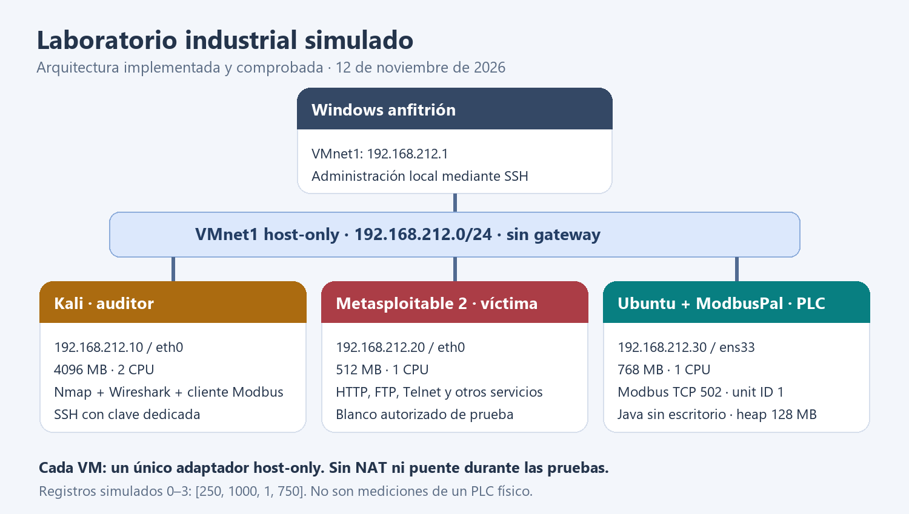

# Laboratorio de ciberseguridad industrial

Guía reproducible para un laboratorio **local y aislado** con Kali, Metasploitable 2 y el motor real de ModbusPal. La práctica de referencia se ejecutó el **12 de noviembre de 2026**; esta documentación se revisó el **16 de noviembre**.

**Lectura del resultado:** [informe PDF paso a paso](docs/latex/informe_visual.pdf), [fuente LaTeX](docs/latex/informe_visual.tex), [informe técnico ampliado](docs/INFORME_TECNICO.md) y [matriz por cada requisito](docs/MATRIZ_CUMPLIMIENTO.md).

La guía académica menciona VirtualBox. Aquí se utiliza VMware por elección del autor: se declara la adaptación, sin atribuirle aprobación docente. ModbusPal funciona mediante su biblioteca Java real con un adaptador propio sin escritorio. Los valores del PLC son simulados, no mediciones físicas.

## Qué contiene y qué no contiene el repositorio

| Ruta | Uso |
|---|---|
| `scripts/windows/` | Preparar carpetas, descargar, crear/importar VMs, fijar huellas y administrar SSH |
| `scripts/kali/` | Preparar herramientas, ejecutar actividades y generar capturas |
| `scripts/plc/` | Fuente Java del adaptador y servicio de ModbusPal |
| `docs/latex/` | Informe editable, PDF e imágenes necesarias para compilar |
| `docs/MATRIZ_CUMPLIMIENTO.md` | Correspondencia de los 22 subítems y nueve entregables |
| `evidencias/ejecuciones/20261112T163453Z-9047/` | Resultados originales de Nmap, PCAP, prueba y manifiesto de la corrida de referencia |
| `evidencias/04-integridad/` | Original conservado, copia alterada y manifiesto |
| `evidencias/capturas/` | Capturas reales para el informe |

`config/`, `descargas/`, `vms/`, dependencias instaladas y auxiliares de compilación son **locales e ignorados por Git**. No se distribuyen claves SSH privadas, contraseñas personales, discos de VM, ISOs ni programas de terceros. El PDF académico original se conserva localmente en `fuentes/`; no se redistribuye. La matriz recoge los requisitos necesarios para revisar la entrega.

El repositorio es privado: clonarlo requiere acceso a la cuenta/repositorio. Las evidencias incluyen **únicamente credenciales sintéticas de Metasploitable** (`msfadmin/msfadmin`), deliberadamente usadas para demostrar el problema; no son credenciales de una cuenta personal. No subir capturas nuevas sin revisarlas primero.

## 1. Requisitos y arquitectura

En Windows, tener PowerShell 7 (entorno de los comandos validados), VMware Workstation, Git, OpenSSH (`ssh`, `scp`, `ssh-keygen`), **Python 3.11+** y un **JDK con `javac --release 8`**. Para el PDF se utilizó TeX Live 2026 con pdfLaTeX; TeXstudio es el editor opcional. Instalar estas herramientas desde sus sitios oficiales antes de continuar.

| Equipo | IP del laboratorio | Recursos del montaje de referencia |
|---|---|---|
| Windows / VMnet1 | `192.168.212.1/24` | Anfitrión con 16 GB de RAM |
| Kali / auditor | `192.168.212.10/24` | 4096 MB, 2 CPU |
| Metasploitable 2 / víctima | `192.168.212.20/24` | 512 MB, 1 CPU |
| Ubuntu + ModbusPal / PLC | `192.168.212.30/24` | 768 MB, 1 CPU; Java con heap máximo 128 MB |



Todos los scripts de auditoría se limitan a `.20` y `.30`. La red de laboratorio `.212` es fija en los clientes y verificadores; si entra en conflicto con otra red del equipo, detener el montaje y adaptar coherentemente todos los componentes antes de usarlo.

### Configurar las redes en VMware

En **Edit → Virtual Network Editor**:

1. Preparar **VMnet1 Host-only**, subred `192.168.212.0`, máscara `255.255.255.0`, adaptador de Windows `.1` y DHCP `.128–.254`. No asociarle NAT ni puente.
2. Conservar **VMnet8 NAT** solo para aprovisionar el Ubuntu limpio y, si hace falta, Kali. En el equipo original era `192.168.123.0/24`, gateway `.2`; el prefijo real se registra en `config/local.json`.
3. No conectar Metasploitable a NAT, puente, Internet ni redes físicas. Retirar de Kali cualquier segundo adaptador antes de auditar. No habilitar ICS ni un puente de Windows sobre VMnet1.

Host-only permite comunicación con Windows: no aísla las VMs frente al anfitrión. La ausencia de gateway y forwarding en los invitados también se verifica antes de cada ejecución.

## 2. Clonar y preparar las carpetas locales

**PowerShell**, en la carpeta donde se quiera guardar el proyecto:

```powershell
git clone https://github.com/Embedar/laboratorio-ciberseguridad-industrial.git
Set-Location laboratorio-ciberseguridad-industrial
python --version
Get-Command git,ssh,scp,ssh-keygen,javac
```

En esta práctica se reutilizó la Kali del autor. Para reproducir desde cero, obtener una **imagen VMware de Kali oficial** en [Get Kali](https://www.kali.org/get-kali/#kali-virtual-machines), verificar sus hashes según la documentación del editor, extraerla y abrir su `.vmx` en VMware. Elegir un usuario propio y cambiar cualquier credencial inicial antes de habilitar su administración. No confundir este procedimiento para un clon nuevo con una instalación de Kali realizada en la corrida original.

Registrar la ruta real de esa Kali y su usuario; sustituir los dos valores del ejemplo:

```powershell
.\scripts\windows\Preparar-Entorno.ps1 -KaliVmx 'C:\ruta\Kali\Kali.vmx' -KaliUser 'kali' -NatPrefix '192.168.123'
python -m pip install --target .\config\legacy-ssh paramiko==3.5.1
python -m pip install --target .\config\python-deps pycdlib
. .\scripts\windows\Get-LabConfig.ps1
$cfg = Get-LabConfig
$vmrun = Join-Path $cfg.VMwareDir 'vmrun.exe'
$vmcli = Join-Path $cfg.VMwareDir 'vmcli.exe'
& $vmrun list
```

`Preparar-Entorno` crea los directorios y `config/local.json`; si ya existe, lo conserva. Para cambiar usuario, ruta o prefijo NAT, editar ese JSON local. La plantilla pública es `config.example.json`. **No guardar contraseñas en el JSON.**

## 3. Preparar Kali y su acceso SSH

### 3.1 Habilitar SSH durante el aprovisionamiento

Con Kali conectada temporalmente a NAT y la víctima todavía apagada, ejecutar **en la consola Linux de Kali**:

```bash
sudo apt-get update
sudo apt-get install -y openssh-server open-vm-tools
sudo systemctl enable --now ssh open-vm-tools
ip -br address
ssh-keygen -lf /etc/ssh/ssh_host_ed25519_key.pub -E sha256
```

Anotar la IP NAT de Kali y la huella `SHA256:...` mostrada **por su consola**. En **PowerShell**, sustituir IP y huella:

```powershell
.\scripts\windows\Preparar-SSH-Kali.ps1 -IpInicial '192.168.123.XXX' -ExpectedHostFingerprint 'SHA256:HUELLA_DE_LA_CONSOLA'
```

El script contrasta la huella antes de autenticar, genera una clave dedicada local, solicita la contraseña en la terminal e instala **solo la clave pública**. Conserva la identidad también para la futura IP `.10`. No aceptar automáticamente una huella distinta.

Transferir los scripts a la IP inicial; sustituir la IP por la observada:

```powershell
$ipKaliInicial = '192.168.123.XXX'
$sshKali = @('-i', "$PWD\config\ssh\kali_ed25519", '-o', 'StrictHostKeyChecking=yes', '-o', "UserKnownHostsFile=$PWD\config\ssh\kali_known_hosts")
& ssh @sshKali "$($cfg.KaliUser)@$ipKaliInicial" 'mkdir -p ~/lab-plc/scripts'
& scp @sshKali -r .\scripts\kali "$($cfg.KaliUser)@${ipKaliInicial}:~/lab-plc/scripts/"
& ssh @sshKali "$($cfg.KaliUser)@$ipKaliInicial" 'bash ~/lab-plc/scripts/kali/bootstrap-kali.sh --aprovisionamiento --capturas'
```

Cerrar y abrir la sesión de Kali para activar el grupo `wireshark`. La opción `--capturas` instala las dependencias gráficas de Xvfb; no es necesaria para leer evidencias ya guardadas.

### 3.2 Pasar Kali al laboratorio aislado

Apagar Kali limpiamente y comprobar **PowerState: off** antes de cambiar su configuración. No continuar si sigue encendida o el apagado no está confirmado:

```powershell
& $vmrun stop $cfg.KaliVmx soft
& $vmcli $cfg.KaliVmx Power query
# Solo después de confirmar off:
& $vmcli $cfg.KaliVmx Ethernet SetConnectionType ethernet0 hostonly
& $vmcli $cfg.KaliVmx ConfigParams SetEntry ethernet0.vnet VMnet1
& $vmcli $cfg.KaliVmx ConfigParams SetEntry memsize 4096
& $vmcli $cfg.KaliVmx ConfigParams SetEntry numvcpus 2
& $vmcli $cfg.KaliVmx ConfigParams SetEntry cpuid.coresPerSocket 2
.\scripts\windows\Verificar-Aislamiento.ps1 -Vmx $cfg.KaliVmx
& $vmrun start $cfg.KaliVmx gui
```

Iniciar sesión manualmente en Kali. Desde **su consola**, identificar la interfaz; en el montaje era `eth0`. Cambiarla si la VM nueva usa otro nombre:

```bash
ip -br address
printf 'net.ipv4.ip_forward=0\nnet.ipv6.conf.all.forwarding=0\n' | sudo tee /etc/sysctl.d/99-lab-plc-aislamiento.conf
sudo sysctl -p /etc/sysctl.d/99-lab-plc-aislamiento.conf
bash ~/lab-plc/scripts/kali/Configurar-red-lab.sh eth0
id
dumpcap -D
ip route
ip -6 route show default
```

Esperado: `.10/24`, sin `default`, forwarding 0 y captura permitida como usuario normal. El cambio de IP se hace desde consola porque corta la sesión SSH inicial. Corroborar desde **PowerShell**:

```powershell
.\scripts\windows\SSH-Kali.ps1 'id; ip -br address; ip route; sysctl net.ipv4.ip_forward; dumpcap -D'
```

## 4. Descargar y preparar los componentes del laboratorio

En **PowerShell**, desde la raíz:

```powershell
.\scripts\windows\Descargar-Dependencias.ps1 -Metasploitable -CompilarWrapper
```

Descarga ModbusPal 1.6b y el ZIP de Metasploitable desde SourceForge, comprueba los bytes/CRC esperados y compila el adaptador Java desde su fuente. Los hashes fijados de esas descargas son referencias locales de la copia usada; **no son firmas del proveedor**. La descarga puede tardar; no importar un `.part`.

El PLC utilizará además el VMDK Ubuntu y `SHA256SUMS` oficiales descargados por su creador. Las descargas, dependencias y `.class` compiladas quedan ignoradas por Git.

## 5. Crear y configurar el PLC simulado

### 5.1 Crear Ubuntu y aprovisionar sus paquetes

```powershell
.\scripts\windows\Crear-PLC.ps1
$plcVmx = Join-Path $PWD 'vms\plc\PLC.vmx'
& $vmrun start $plcVmx nogui
& $vmrun getGuestIPAddress $plcVmx
```

Esperar el arranque y cloud-init. Si VMware Tools todavía no responde, repetir la consulta al terminar el arranque o consultar el lease de la MAC `00:50:56:22:00:30` en `C:\ProgramData\VMware\vmnetdhcp.leases`. Solo esta VM limpia usa NAT durante la instalación de paquetes.

Obtener la huella pública de host desde la consola/registro serial generado por la misma VM:

```powershell
Select-String -LiteralPath .\vms\plc\serial-boot.log -Pattern 'ED25519|SHA256:'
# Sustituir con IP y huella reales; no copiar valores de la corrida de ejemplo:
.\scripts\windows\Finalizar-PLC.ps1 -IpAprovisionamiento '192.168.123.XXX' -ExpectedHostFingerprint 'SHA256:HUELLA_DE_LA_CONSOLA_SERIAL'
```

El finalizador espera cloud-init, contrasta/fija la identidad, prepara el netplan, apaga limpiamente, cambia a host-only y espera SSH en `.30`. Conserva el match por MAC/nombre de interfaz que resolvió la incidencia del montaje original. Si falla cualquier comprobación, revisar el mensaje antes de continuar.

### 5.2 Instalar ModbusPal y corroborar su respuesta

```powershell
.\scripts\windows\Instalar-PLC.ps1
.\scripts\windows\SSH-PLC.ps1 'ip -br address; ip route; sysctl net.ipv4.ip_forward net.ipv6.conf.all.forwarding; systemctl is-active modbuspal-lab'
.\scripts\windows\Verificar-Aislamiento.ps1 -Vmx $plcVmx
.\scripts\windows\SSH-Kali.ps1 'python3 ~/lab-plc/scripts/kali/modbus_read.py --host 192.168.212.30 --port 502 --unit 1 --address 0 --count 4'
```

Esperado: servicio activo, sin gateway, forwarding 0 y registros `[250,1000,1,750]`. Un puerto abierto no basta: el instalador espera una respuesta FC03 válida. Dirección PDU 0 significa el primer registro solicitado; no confundirla con la notación de referencia 40001.

## 6. Importar y configurar la víctima

```powershell
python .\scripts\windows\Importar-Metasploitable.py
$victimaVmx = (Get-Content .\config\victima-importada.json -Raw | ConvertFrom-Json).vmx
.\scripts\windows\Verificar-Aislamiento.ps1 -Vmx $victimaVmx
& $vmrun start $victimaVmx nogui
Select-String -LiteralPath $victimaVmx -Pattern 'ethernet0.generatedAddress'
Get-Content -LiteralPath 'C:\ProgramData\VMware\vmnetdhcp.leases' -Tail 80
```

Identificar el lease `.212.128–.254` de **esa MAC**. En la consola de Metasploitable se puede entrar con la credencial pública del entorno `msfadmin/msfadmin`; consultar la huella de host:

```bash
ssh-keygen -lf /etc/ssh/ssh_host_rsa_key.pub
```

El OpenSSH antiguo suele mostrar MD5 con 16 pares hexadecimales. Copiar ese valor de consola y anteponer `MD5:` si falta. Después ejecutar en **PowerShell**, con IP/huella reales:

```powershell
python .\scripts\windows\Configurar-Victima.py --ip '192.168.212.XXX' --expected-host-fingerprint 'MD5:HUELLA_DE_CONSOLA'
.\scripts\windows\SSH-Victima.ps1 'id; ifconfig eth0; route -n; /sbin/sysctl net.ipv4.ip_forward'
```

El bootstrap comprueba MAC/lease y huella antes de autenticar, instala una clave RSA dedicada compatible con el SSH antiguo, desactiva DHCP y fija `.20/24` sin gateway. Las excepciones de algoritmos SSH se limitan al helper de esta VM; no se debilita SSH globalmente. El importador rechaza sobrescribir una VM existente.

## 7. Comprobar el montaje antes de cada práctica

En **PowerShell**:

```powershell
.\scripts\windows\Laboratorio.ps1 -Accion Estado
# Si las tres VMs ya están configuradas pero apagadas:
.\scripts\windows\Laboratorio.ps1 -Accion Iniciar
```

En **Kali**, revisar también:

```bash
ip -br address
ip -4 route show table all
ip -6 route show table all
sysctl net.ipv4.ip_forward net.ipv6.conf.all.forwarding
dumpcap -D
```

Debe existir solo la interfaz operativa del laboratorio con `.10/24`, sin rutas por defecto y forwarding 0. Un bridge Docker en estado DOWN se documenta y no se utiliza. No iniciar los sondeos si aparece un adaptador activo adicional, NAT/puente en un VMX o una ruta externa.

## 8. Ejecutar las cuatro actividades

### Modo automático: la secuencia usada en la práctica

Desde **PowerShell** (cambiar `eth0` si se verificó otro nombre):

```powershell
.\scripts\windows\SSH-Kali.ps1 'bash ~/lab-plc/scripts/kali/Ejecutar-practica.sh eth0'
```

El script hace preflight, descubrimiento, Nmap, captura de 90 segundos, HTTP, tres lecturas Modbus, prueba Telnet, FTP opcional y SHA-256. Crea una **corrida nueva UTC/PID**, imprime su ruta y conserva fallos explícitos. Un error no acredita las actividades posteriores. No se reutilizan resultados de la corrida de referencia.

### Comandos de cada actividad, para comprender o repetir manualmente

Estos comandos se ejecutan **en Bash de Kali** como alternativa al modo automático. Primero realizar las comprobaciones del paso 7. Mantener abierta la misma terminal para conservar `RUN` e `IFACE`:

```bash
export IFACE=eth0
export RUN="$HOME/lab-plc/evidencias/manual/$(date -u +%Y%m%dT%H%M%SZ)-$$"
mkdir -p "$RUN"/{01-nmap,02-trafico,03-vulnerabilidad,04-integridad}
date -Is | tee "$RUN/inicio.txt"

# Actividad 1: activos, IP, puertos y servicios.
nmap -n -sn -PS22,502 192.168.212.20 192.168.212.30 -oA "$RUN/01-nmap/descubrimiento"
nmap -n -sT -sV -sC --version-light --script-timeout 30s --host-timeout 600s -p- 192.168.212.20 -oA "$RUN/01-nmap/metasploitable"
nmap -n -sT -sV -sC --version-light --script-timeout 30s -p 22,502 192.168.212.30 -oA "$RUN/01-nmap/plc"

# Actividad 2: iniciar captura antes de generar tráfico.
dumpcap -i "$IFACE" -f 'host 192.168.212.20 or host 192.168.212.30' -a duration:90 -w "$RUN/02-trafico/comunicaciones.pcapng" > "$RUN/02-trafico/dumpcap.log" 2>&1 &
CAPTURE_PID=$!
sleep 2
kill -0 "$CAPTURE_PID" || { cat "$RUN/02-trafico/dumpcap.log"; exit 1; }
curl --noproxy '*' --connect-timeout 5 --max-time 15 -f -v --dump-header "$RUN/02-trafico/http-headers.txt" --output "$RUN/02-trafico/http-body.html" http://192.168.212.20/ 2> "$RUN/02-trafico/http-curl.log"
for attempt in 1 2 3; do
  python3 ~/lab-plc/scripts/kali/modbus_read.py --host 192.168.212.30 --port 502 --unit 1 --address 0 --count 4 | tee -a "$RUN/02-trafico/modbus.txt"
  sleep 1
done

# Actividad 3: prueba controlada exclusivamente contra .20.
set -o pipefail
python3 ~/lab-plc/scripts/kali/Prueba-Telnet.py --host 192.168.212.20 --timeout 15 | tee "$RUN/03-vulnerabilidad/telnet.txt"
curl --noproxy '*' --connect-timeout 5 --max-time 15 --user 'anonymous:lab@example.invalid' -v ftp://192.168.212.20/ > "$RUN/03-vulnerabilidad/ftp-anonimo.txt" 2>&1
wait "$CAPTURE_PID"

# Analizar la captura ya cerrada.
tshark -r "$RUN/02-trafico/comunicaciones.pcapng" -q -z io,phs | tee "$RUN/02-trafico/protocolos.txt"
tshark -r "$RUN/02-trafico/comunicaciones.pcapng" -Y 'http or modbus or telnet' -T fields -E header=y -e frame.number -e ip.src -e ip.dst -e tcp.srcport -e tcp.dstport -e _ws.col.Protocol -e modbus.func_code | tee "$RUN/02-trafico/paquetes.tsv"

# Actividad 4: conservar original, alterar únicamente una copia y comparar.
bash ~/lab-plc/scripts/kali/Integridad.sh "$RUN/02-trafico/comunicaciones.pcapng" | tee "$RUN/04-integridad/resultado.txt"
# El script imprime la carpeta con SHA256SUMS.txt, ambas copias y verificación.
```

El modo manual es didáctico: ante un fallo, detenerse, conservar el log y corregir la causa antes de seguir. Para una ejecución con parada automática y registro de todos los comandos, usar el modo automático.

## 9. Revisar Wireshark y documentar cada requisito

En Kali, abrir la captura cerrada de **la corrida propia**:

```bash
wireshark -r "$RUN/02-trafico/comunicaciones.pcapng"
```

| Revisión | Filtro / qué explicar |
|---|---|
| TCP | `tcp`: localizar SYN, SYN-ACK y ACK de una conexión |
| HTTP | `http`: solicitud y respuesta, IP/puerto de origen y destino, método, URI y estado |
| Modbus | `modbus` o `tcp.port == 502`: unidad, función03, dirección inicial0, cantidad4 y valores |
| Telnet | `telnet`: sesión de la prueba, usuario y credencial sintética en claro |

Los números de trama del informe pertenecen a la ejecución del 12 de noviembre; **no son valores fijos para otras capturas**. Relacionar solicitudes/respuestas de la propia corrida.

Para capturas gráficas automáticas reales sin desbloquear el escritorio:

```bash
dbus-run-session -- xvfb-run -a -s '-screen 0 1280x800x24 -nolisten tcp' bash ~/lab-plc/scripts/kali/Capturar-Evidencias-Xvfb.sh "$RUN"
```

La herramienta toma el directorio indicado y descubre las tramas HTTP/Modbus; no debe mostrar datos de otra corrida. Conservar los archivos originales además de las imágenes.

## 10. Exportar, verificar e inspeccionar en FTK

Copiar los resultados a Windows. En **PowerShell**, sustituir `ID_REAL` por la ruta final impresa por el modo automático:

```powershell
$corrida = 'ID_REAL'
$sshKali = @('-i', "$PWD\config\ssh\kali_ed25519", '-o', 'StrictHostKeyChecking=yes', '-o', "UserKnownHostsFile=$PWD\config\ssh\kali_known_hosts")
& scp @sshKali -r "$($cfg.KaliUser)@192.168.212.10:~/lab-plc/evidencias/ejecuciones/$corrida" .\evidencias\ejecuciones\
# Copiar también la carpeta de integridad que imprimió Integridad.sh.
& scp @sshKali -r "$($cfg.KaliUser)@192.168.212.10:~/lab-plc/evidencias/04-integridad" .\evidencias\
Get-FileHash -Algorithm SHA256 ".\evidencias\ejecuciones\$corrida\02-trafico\comunicaciones.pcapng"
```

Comparar el hash con el registrado en Kali. Para la **corrida de referencia incluida**, la comprobación automática es:

```powershell
python .\scripts\windows\Verificar-Evidencias.py
```

Ese verificador comprueba los 28 hashes de sus dos manifiestos y el formato/presencia de siete capturas; no significa «35 hashes». Para una corrida nueva, verificar su propio manifiesto con `sha256sum -c SHA256SUMS.txt` en Linux o calcular las mismas entradas con Get-FileHash. Cada OK se refiere a su entrada: original y copia alterada deben tener **hashes diferentes**.

En **FTK Imager**, instalado desde su distribución oficial:

1. File → Add Evidence Item → Contents of a Folder; elegir la carpeta `02-trafico` exportada.
2. Expandir el árbol y seleccionar `comunicaciones.pcapng`.
3. Registrar propiedades, tamaño y vista hexadecimal; guardar una captura.
4. Volver a corroborar SHA-256 externamente con Get-FileHash.

Esto documenta revisión lógica de archivos; no es una adquisición física ni acredita un AD1. La actividad4 pide cálculo/comparación de hashes y está cubierta por ese ejercicio. No atribuir a FTK un hash calculado externamente.

## 11. Preparar el informe y revisar la entrega

La [matriz](docs/MATRIZ_CUMPLIMIENTO.md) relaciona cada subítem con evidencia y sección. Conservar:

1. Diagrama del montaje y tabla dispositivo/IP/puerto/servicio.
2. Nmap original y captura; Wireshark/PCAP y análisis TCP, HTTP y Modbus.
3. Investigación, prueba controlada, resultado, impacto y mitigación.
4. Original, copia alterada, hashes y explicación de integridad.
5. Al menos tres riesgos respaldados, recomendaciones y conclusiones.

Investigar con [Rapid7](https://help.rapid7.com/metasploit/Content/getting-started/setting-up-test-env.html), [CWE-1392](https://cwe.mitre.org/data/definitions/1392.html), [CWE-319](https://cwe.mitre.org/data/definitions/319.html) y [ftp-anon de Nmap](https://nmap.org/nsedoc/scripts/ftp-anon.html). No afirmar una CVE explotada por observar un banner. En la referencia se confirmó Telnet con credencial predeterminada y FTP anónimo vacío; no se probó escritura Modbus ni extracción de archivos.

Para compilar el informe LaTeX de referencia:

```powershell
Push-Location .\docs\latex
.\compilar.ps1
Pop-Location
```

Si se realiza otra corrida, actualizar tablas, tramas, hashes, imágenes y conclusiones. No reutilizar el informe de referencia como si acreditara una ejecución diferente.

## 12. Mantener el repositorio sin publicar material privado

Tras revisar los cambios propios, desde **PowerShell**:

```powershell
git status --short
git add README.md ESTADO_ACTUAL.md .gitignore .gitattributes config.example.json docs scripts evidencias
python .\scripts\windows\Validar-Publicacion.py --staged
git diff --cached --stat
# Solo si la validación termina sin errores y los cambios son los deseados:
git commit -m "Documentar y verificar el laboratorio industrial"
git push origin main
```

`.gitignore` excluye los artefactos locales; el validador inspecciona **los bytes preparados para el commit**, rechaza claves/tokens, archivos no permitidos y binarios de VM/terceros. No publicar claves aunque el repositorio sea privado. El script no verifica que un texto académico sea correcto: revisar la matriz y los resultados sigue siendo necesario.

## Resultado de la ejecución incluida

- Dos blancos activos, 30 puertos TCP abiertos en la víctima y 22/502 comprobados en el PLC.
- PCAP de 154 tramas y20.940 bytes; HTTP200, tres intercambiosFC03 y registros `[250,1000,1,750]`.
- Acceso Telnet como msfadmin y FTP anónimo con listado vacío.
- PCAP/original: `d33b57daa6af812c89638e4aaaac74c9a910f7a730d3ba5372326f81fa69d68c`.
- Copia alterada: `75729913650b748c5889879b7e357d9a1759fd8f60f0ad37383b8b63305e48ec`.
- Carpeta y PCAP inspeccionados en FTK; no se creó AD1. Las mitigaciones son propuestas, no cambios aplicados a la víctima.

## Problemas frecuentes

| Problema | Qué revisar |
|---|---|
| SSH no responde | Arranque, IP/MAC/lease, servicio SSH y red correcta; no desactivar globalmente la comprobación de identidad |
| Huella distinta | Detener la autenticación y comparar con la consola de la VM antes de sustituir una entrada |
| PLC pierde IP tras reinicio | Match por MAC y nombre persistente de interfaz en netplan; usar el finalizador corregido |
| Captura denegada | Grupo wireshark, nueva sesión y `dumpcap -D`; no ejecutar toda la práctica como root |
| Preflight bloqueado | IP `.10`, ausencia de default/IPv6 global, forwarding0 y único adaptador host-only |
| Puerto502 abierto pero lectura falla | Servicio, unit1/FC03/dirección0/cantidad4 y logs de ModbusPal |
| Se intenta repetir la creación | Los creadores rechazan una VM existente; no borrar discos para resolverlo. Usar otro entorno y planificar IP/MAC únicas |

La guía no requiere modificar el firmware ni los archivos del robot STM32. Para apagar ordenadamente cada VM, entrar con su helper SSH y ejecutar `sudo shutdown -h now`.


