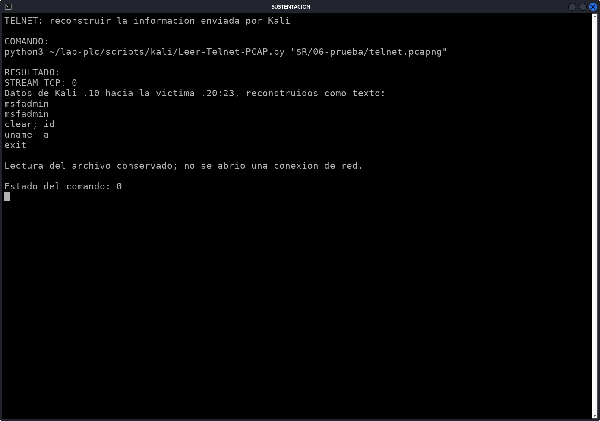

# Telnet y análisis de su tráfico: conceptos y lectura

La demostración se presenta en el apartado 6 del informe. La [guía de sustentación](SUSTENTACION_PASO_A_PASO.md) contiene las órdenes por separado.

## 1. Qué son TCP, un puerto y Telnet

**IP, Internet Protocol**, permite identificar los equipos de esta red: Kali tiene `192.168.212.10`; la víctima, `192.168.212.20`. Cuando el informe abrevia `.10` o `.20`, se refiere a esas direcciones completas.

**TCP, Transmission Control Protocol**, transporta un flujo de bytes entre dos extremos con control de orden y entrega. No proporciona cifrado por sí mismo. Cada extremo se identifica por una dirección IP y un puerto.

Un **puerto** es un número utilizado para dirigir la conexión al servicio correspondiente. El servidor Telnet de la víctima escuchaba en el puerto **23**; Kali utilizó el puerto temporal un puerto temporal en cada sesión:

```text
Kali (cliente)                         Metasploitable 2 (servidor)
192.168.212.10:puerto-temporal  <---- TCP ---->   192.168.212.20:23
```

**Telnet** es un protocolo de terminal remota: permite escribir desde un equipo y recibir preguntas o resultados del otro. El cliente envía respuestas a `login:` y `Password:`; si el servidor las acepta, permite utilizar una terminal remota. La [especificación RFC 854](https://www.rfc-editor.org/rfc/rfc854) describe su uso sobre TCP. En esta sesión, los datos viajaron sin cifrarse.

Un puerto abierto indica que es posible contactar un servicio. La autenticación aceptada y el tráfico observado son las comprobaciones posteriores que permiten describir las debilidades.

## 2. Qué son Rapid7, MITRE, CWE y CVE

| Término | Significado | Papel en esta práctica |
|---|---|---|
| Rapid7 | Empresa de ciberseguridad cuya documentación oficial presenta Metasploitable 2 y su credencial de laboratorio | Fuente para conocer el entorno y la credencial pública; no se ejecutó un programa llamado Rapid7 |
| MITRE | Nombre de una organización sin ánimo de lucro que participa en iniciativas de conocimiento de ciberseguridad | Se consultó el catálogo CWE publicado en su sitio; no se instaló MITRE en una VM |
| CWE | Common Weakness Enumeration: catálogo de tipos de debilidades | Permite clasificar la condición observada |
| CWE-1392 | Categoría «Use of Default Credentials»: uso de credenciales predeterminadas | Se relaciona con que la víctima aceptó `msfadmin/msfadmin` |
| CWE-319 | Categoría «Cleartext Transmission of Sensitive Information»: transmisión de información sensible en claro | Se relaciona con la contraseña legible en el tráfico |
| CVE | Common Vulnerabilities and Exposures: sistema de identificadores de vulnerabilidades concretas divulgadas públicamente | Sus identificadores tienen forma `CVE-año-número`. Esta práctica no demostró explotación de una CVE específica |

Los números **1392 y 319 identifican categorías de debilidad**. No son puertos ni números de trama. Las referencias ayudan a explicar lo observado; la demostración procede de las evidencias del laboratorio.

Fuentes: [Rapid7, Metasploitable 2](https://docs.rapid7.com/metasploit/metasploitable-2/), [MITRE, organización](https://www.mitre.org/who-we-are), [CWE-1392](https://cwe.mitre.org/data/definitions/1392.html), [CWE-319](https://cwe.mitre.org/data/definitions/319.html) y [descripción del programa CVE](https://www.cve.org/Resources/Media/Archives/OldWebsite/index.html).


## 3. Secuencia observada

Se abrió Telnet contra .20:23, se esperó la petición de usuario, se introdujo msfadmin y después la misma contraseña pública. `id` confirmó uid 1000; `uname -a` consultó el sistema y `exit` cerró la sesión. Las imágenes 11a–11d muestran cada estado.

## 4. Archivo y tramas

PCAP significa Packet Capture; el formato usado es PCAPNG. Dumpcap registra bytes y metadatos de la interfaz, Wireshark los interpreta gráficamente y TShark permite consultarlos en terminal. Una trama es una fila numerada dentro de ese archivo, no una línea de la terminal.

Esta demostración conserva la sesión en `evidencias/sustentaciones/20261117T124816Z-27489/06-prueba/telnet.pcapng`. No se buscan las tramas 65/70 de la corrida anterior: se aplica `telnet` o se sigue la conversación con Follow→TCP Stream.



El lector `Leer-Telnet-PCAP.py` consulta los bytes con TShark, retira controles de negociación Telnet y muestra los datos del cliente como texto. Las dos apariciones de msfadmin corresponden al usuario y contraseña según las preguntas del servidor. La contraseña no se cifró, aunque su eco estuviera oculto en la terminal. Un observador necesita acceso al trayecto o al archivo para leerla; no se afirma que hubiera un tercero escuchando.

## 5. Interpretación

La autenticación aceptada respalda la condición de credencial predeterminada; el tráfico legible muestra el canal inseguro. Se recomienda cambiar credenciales y retirar Telnet, usando SSH con autenticación adecuada. La comprobación posterior sería rechazo de la credencial previa y TCP 23 cerrado. Estas medidas se proponen sin retirar las condiciones de la víctima didáctica.
