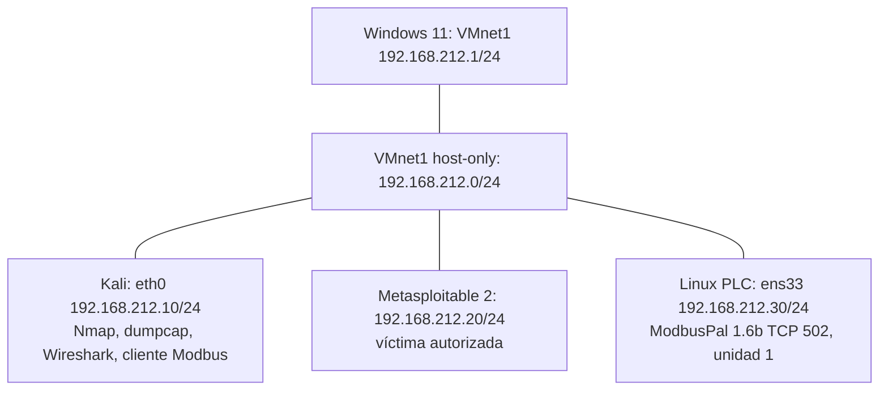
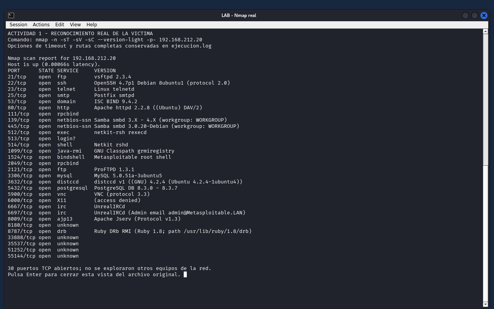
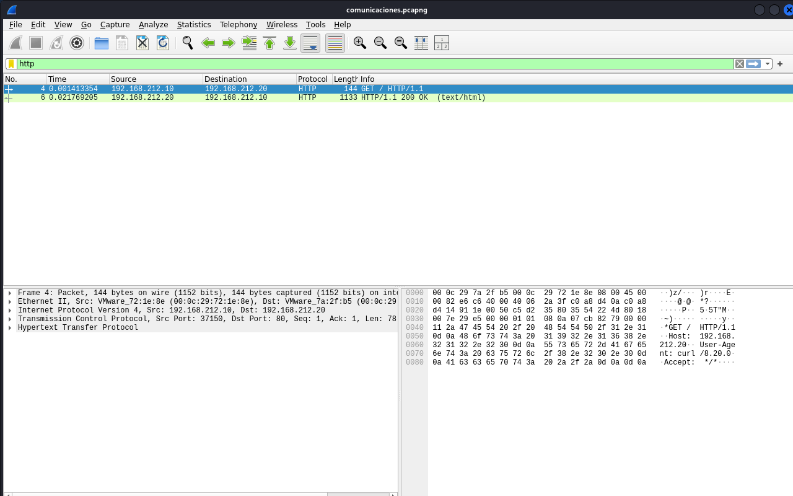
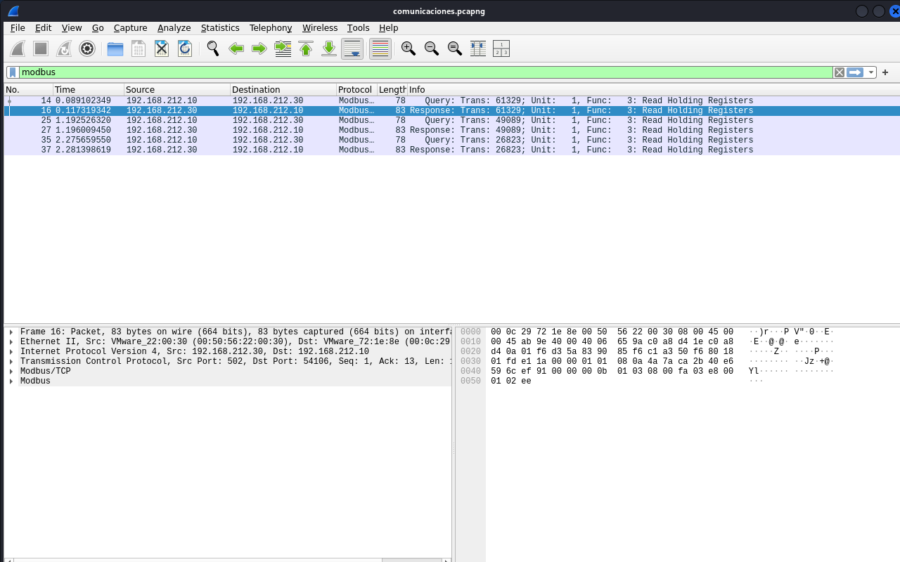
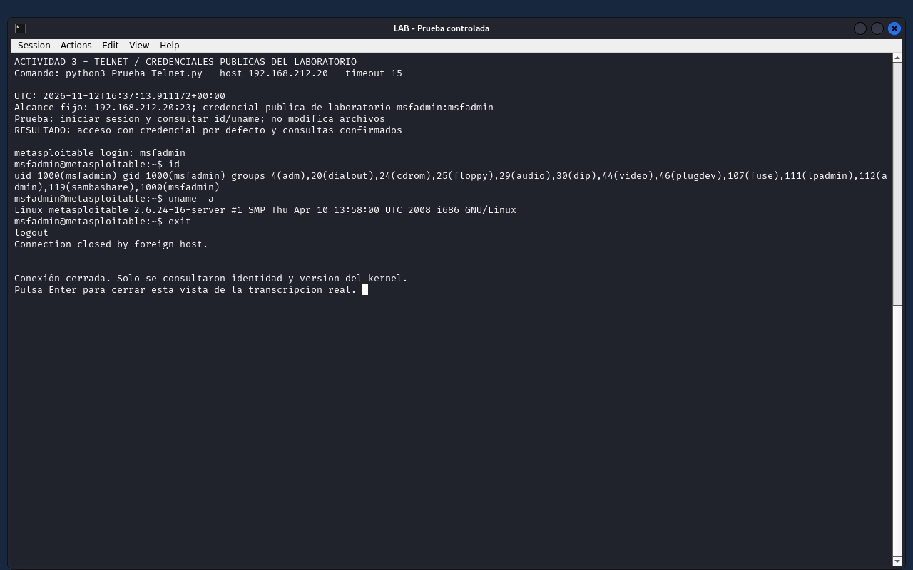
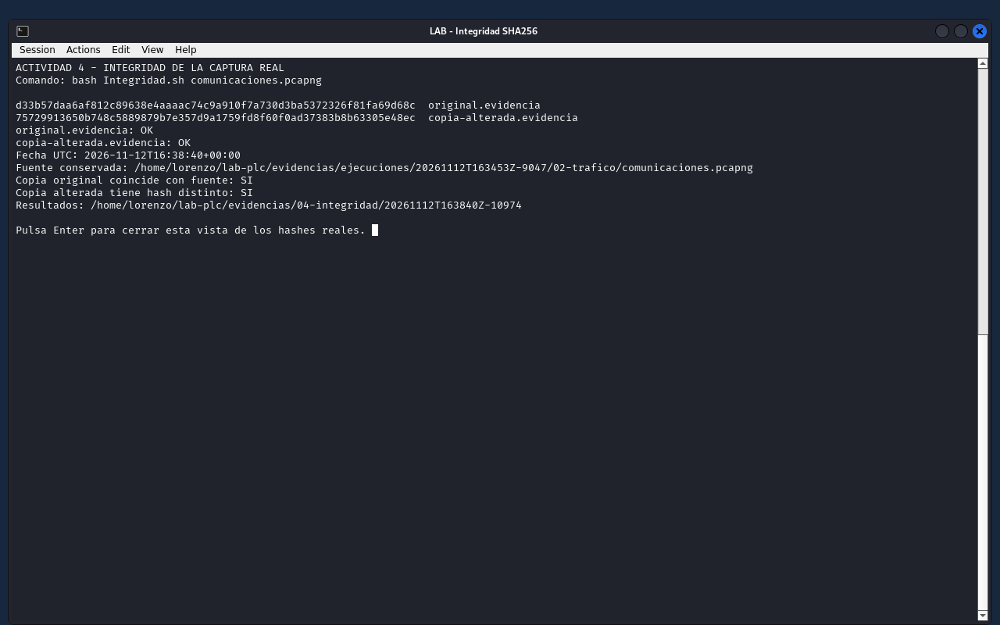
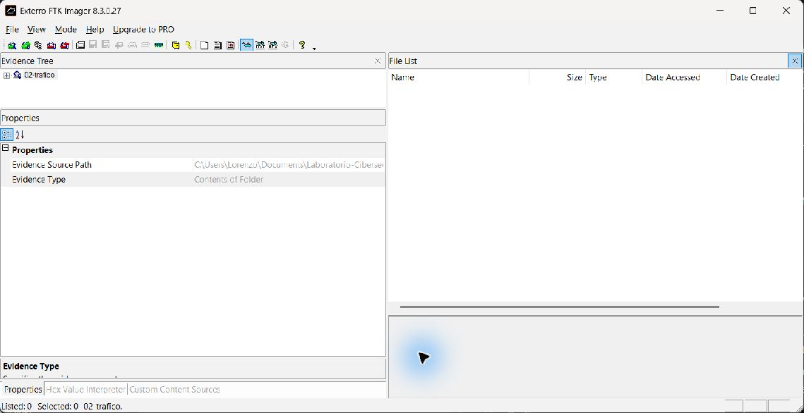
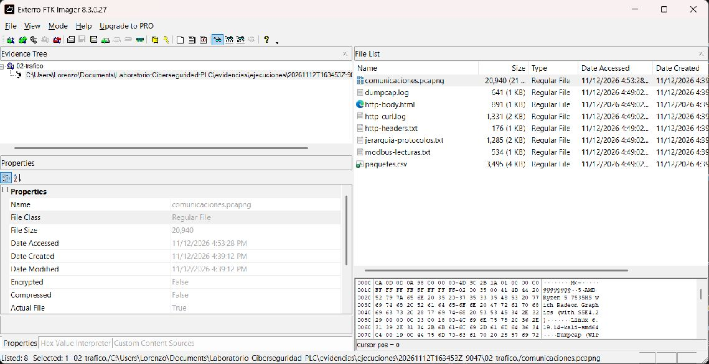

# Informe técnico: auditoría de una infraestructura industrial simulada

Práctica ejecutada el **12 de noviembre de 2026**, de 11:34:53 a 11:38:40, hora de Bogotá (UTC−05:00; registros UTC 16:34:53–16:38:40). La ejecución `20261112T163453Z-9047` terminó sin errores de comandos. Los resultados se apoyan en XML de Nmap, una captura real de 154 tramas, registros de aplicación y verificación SHA-256. El nombre del estudiante o integrantes debe añadirse antes de la entrega académica.

Curso: Ciberseguridad en la Industria, Universidad Santo Tomás. Docente: John Monzaide Alvarez Cely. Fuente académica: `C:\Users\Lorenzo\Downloads\Práctica_Ciberseguridad.pdf`, secciones 4 a 10.

**Estado FTK:** carpeta incorporada y PCAP inspeccionado, con propiedades y bytes observados y capturas conservadas. No se ha adquirido una imagen AD1. La actividad 4 de hashes sí se ejecutó sobre una evidencia real.

## 1. Objetivo, alcance y metodología

Se reconocieron servicios de dos máquinas autorizadas, se analizaron comunicaciones TCP, HTTP y Modbus TCP, se probaron credenciales predeterminadas por Telnet y acceso FTP anónimo, y se verificó la integridad de la evidencia capturada. No se realizaron pruebas contra la red física, Internet ni dispositivos industriales reales.

VMware Workstation **26.0.0 build-25388281** administra el laboratorio sobre Windows 11 Home. Se reutilizó la VM Kali del usuario y se incorporaron una VM Metasploitable 2 y una VM Linux PLC. La administración se realizó mediante herramientas locales de VMware y SSH; SSH pertenece al sistema invitado, no es el protocolo de creación de VMs. El diagnóstico de Kali acredita su servicio SSH activo.

Se ejecutó `scripts/kali/Ejecutar-practica.sh eth0`. Su comprobación previa exige dirección `.10/24`, rutas directas a `.20/.30`, ausencia de rutas por defecto IPv4/IPv6 y reenvío desactivado. El verificador estático de los tres VMX registró un único adaptador host-only antes de las pruebas. Esa comprobación estática no sustituye revisar rutas e interfaces de cada invitado ni demuestra por sí sola ausencia absoluta de ICS en Windows.

El PLC usa el **motor real ModbusPal 1.6b**, integrado mediante `ModbusPalHeadless.java`; se ejecuta sin su ventana gráfica original, como servicio `modbuspal-lab`. Esta adaptación permite capturar el protocolo solicitado, pero no acredita una captura de la GUI de ModbusPal. El registro `evidencias/host/plc-final.txt` muestra el servicio activo, escucha TCP 502 y la interfaz `ens33` con `.30/24`, sin gateway en la tabla observada. Los mensajes Fontconfig del registro no impidieron las lecturas TCP posteriores.

### Montaje realizado: síntesis verificable

La actividad se realizó el **12 de noviembre de 2026**; esta síntesis se revisó documentalmente el **16 de noviembre de 2026**. No describe una nueva ejecución ni un nuevo escaneo.

1. Se inventariaron Windows y VMware y se reutilizó la Kali existente, con SSH activo; no se instaló otra Kali ni se duplicó su disco.
2. Se descargó e importó Metasploitable 2, preservando respaldo de configuración y fijando un adaptador host-only, 512 MB y 1 CPU. El ZIP pasó CRC y se registró SHA-256 local: son controles de integridad, no firma ni autenticación del editor.
3. Se configuró la víctima como 192.168.212.20/24 y se verificó SSH por clave; su registro posterior muestra ruta de laboratorio sin gateway y forwarding IPv4 desactivado.
4. Se preparó una nueva VM PLC de 768 MB/1 CPU a partir del VMDK Ubuntu y semilla NoCloud. El hash se contrastó con el listado oficial descargado; no se afirma verificación de firma GPG del listado.
5. El PLC limpio usó NAT temporal para obtener SSH, VMwareTools y Java; después quedó host-only .30 sin gateway. La incidencia del nombre de interfaz se corrigió mediante coincidencia MAC y nombre persistente ens33; la víctima no recibió NAT para la práctica.
6. Se instaló el motor real ModbusPal 1.6b con un adaptador Java propio sin GUI y servicio systemd como lab, con capacidad limitada para escuchar 502. Se configuraron los cuatro enteros simulados [250,1000,1,750].
7. Se verificaron VMX, rutas e interfaces y se ejecutó la auditoría acotada: Nmap, captura real, HTTP, lectura FC03, Telnet, FTP y comparación SHA-256 de evidencia original/copia.
8. Se exportaron y verificaron las evidencias, se generaron vistas Kali reales mediante Xvfb por SSH y se incorporó/inspeccionó el PCAP en FTK Windows, sin crear AD1 y sin atribuir a FTK el hash calculado externamente.

ModbusPal generó las respuestas industriales registradas. Las rutas de evidencia y el alcance de las pruebas se detallan en las secciones siguientes.

## 2. Diagrama e inventario de infraestructura




| Dispositivo | Dirección IP | Puertos TCP identificados | Servicios y función |
|---|---|---|---|
| Windows anfitrión | 192.168.212.1/24 | No sondeados | Administración de la red virtual; fuera de los blancos |
| Kali (auditor) | 192.168.212.10/24 | 22 comprobado mediante SSH; no inventariado con Nmap | SSH administrativo; clientes de auditoría Nmap, Wireshark y Modbus |
| Metasploitable 2 | 192.168.212.20/24 | 21,22,23,25,53,80,111,139,445,512,513,514,1099,1524,2049,2121,3306,3632,5432,5900,6000,6667,6697,8009,8180,8787,33888,35537,51252,55144 | FTP, SSH, Telnet, SMTP, DNS, HTTP, RPC, SMB, rsh, RMI, shell, NFS, MySQL, distccd, PostgreSQL, VNC, X11, IRC, AJP, DRb y cinco puertos unknown. La sección 3 empareja cada puerto y servicio |
| Ubuntu + ModbusPal (PLC) | 192.168.212.30/24 | 22 y 502; solo se sondearon estos puertos | SSH (OpenSSH 9.6p1) y Modbus TCP confirmado por FC03 |


Kali conserva `docker0` con `172.17.0.1/16` en estado **DOWN**, sin portadora; no se utilizó para las pruebas y no se modificó Docker. Las rutas conservadas no muestran ruta por defecto en Kali. Host-only incluye al anfitrión y no ofrece aislamiento frente a este. El servicio NAT de VMware instalado en Windows no implica que estas VMs tengan un adaptador NAT: los VMX revisados registran host-only.

Evidencias: `evidencias/aislamiento/vmx-20261112-113453-125.json`, `evidencias/host/plc-final.txt` y `evidencias/ejecuciones/20261112T163453Z-9047/00-preflight/`.

## 3. Reconocimiento Nmap y tabla de servicios

Se identificaron los dos blancos activos con `-n -sn -PS22,502`. La víctima se examinó en los **65535 puertos TCP** mediante conexión TCP `-sT`, detección de versiones `-sV`, scripts predeterminados `-sC` y `--version-light`. Nmap **7.99** registró **30 puertos abiertos y 65505 cerrados**, con duración de 100.39 segundos. El PLC se examinó **solo en TCP 22 y 502**, ambos abiertos, durante 35.56 segundos. No es un inventario UDP ni una afirmación de que el PLC carezca de otros puertos.

Comandos ejecutados, cuyo destino de salida exacto figura en `ejecucion.log` y en los XML:

```bash
R="$HOME/lab-plc/evidencias/ejecuciones/20261112T163453Z-9047"
nmap -n -sn -PS22,502 192.168.212.20 192.168.212.30 -oA "$R/01-nmap/descubrimiento"
nmap -n -sT -sV -sC --version-light --script-timeout 30s --host-timeout 600s -p- 192.168.212.20 -oA "$R/01-nmap/metasploitable"
nmap -n -sT -sV -sC --version-light --script-timeout 30s -p 22,502 192.168.212.30 -oA "$R/01-nmap/plc"
```

### Víctima 192.168.212.20: inventario completo observado

Todos los puertos de esta tabla son TCP y estaban abiertos. Los nombres y versiones son resultados de detección de Nmap; no equivalen a CVE confirmadas.

| Puerto | Servicio detectado | Producto, versión o nota observada |
|---|---|---|
| 21 | ftp | vsftpd 2.3.4; script ftp-anon acepta usuario anónimo, código 230 |
| 22 | ssh | OpenSSH 4.7p1 Debian 8ubuntu1, protocolo 2.0 |
| 23 | telnet | Linux telnetd |
| 25 | smtp | Postfix smtpd |
| 53 | domain | ISC BIND 9.4.2 |
| 80 | http | Apache httpd 2.2.8, Ubuntu DAV/2 |
| 111 | rpcbind | Sin versión determinada |
| 139 | netbios-ssn | Samba smbd 3.X–4.X, WORKGROUP |
| 445 | netbios-ssn | Samba smbd 3.0.20-Debian, WORKGROUP |
| 512 | exec | netkit-rsh rexecd |
| 513 | login? | Identificación incierta, no confirmada manualmente |
| 514 | shell | Netkit rshd |
| 1099 | java-rmi | GNU Classpath grmiregistry |
| 1524 | bindshell | Nmap lo identifica como Metasploitable root shell; no se utilizó |
| 2049 | rpcbind | Etiqueta observada de Nmap; no se reclasifica sin confirmación |
| 2121 | ftp | ProFTPD 1.3.1 |
| 3306 | mysql | MySQL 5.0.51a-3ubuntu5 |
| 3632 | distccd | distccd v1, GNU 4.2.4, Ubuntu 4.2.4-1ubuntu4 |
| 5432 | postgresql | PostgreSQL DB 8.3.0–8.3.7, rango detectado |
| 5900 | vnc | Protocolo 3.3, autenticación VNC anunciada |
| 6000 | X11 | Acceso denegado según detección |
| 6667 | irc | UnrealIRCd |
| 6697 | irc | UnrealIRCd |
| 8009 | ajp13 | Apache Jserv, protocolo 1.3 |
| 8180 | unknown | Script HTTP obtiene título Apache Tomcat/5.5; clasificación incierta |
| 8787 | drb | Ruby DRb RMI, Ruby 1.8 |
| 33888 | unknown | Sin identificación suficiente |
| 35537 | unknown | Sin identificación suficiente |
| 51252 | unknown | Sin identificación suficiente |
| 55144 | unknown | Sin identificación suficiente |

### PLC 192.168.212.30: puertos examinados

| Puerto TCP | Estado | Resultado Nmap | Confirmación adicional |
|---|---|---|---|
| 22 | Abierto | OpenSSH 9.6p1 Ubuntu 3ubuntu13.20 | Administración SSH del invitado |
| 502 | Abierto | `mbap?`, identificación tentativa | Tres respuestas FC03 válidas, registro del servicio ModbusPal y captura Modbus TCP |

Fuentes originales: `01-nmap/metasploitable.xml`, `01-nmap/plc.xml` y sus representaciones `.nmap/.gnmap`, dentro de la ejecución indicada. La captura `evidencias/capturas/01-nmap.png` acompaña estos archivos, que contienen más información que una pantalla.

## 4. Captura y análisis TCP, HTTP y Modbus

Se capturó en Kali `eth0` con **dumpcap sin sudo**, con permisos de captura preparados previamente, filtro limitado a `.20` o `.30`, y duración de 90 segundos. La captura `02-trafico/comunicaciones.pcapng` tiene **154 tramas**; el registro informa 154 recibidas y 0 descartadas en la interfaz durante esta captura. La jerarquía TShark registra 133 tramas TCP, 2 HTTP, 6 Modbus TCP, 33 Telnet y 16 FTP. Estas categorías están anidadas, por lo que no se suman como si fueran independientes.

La captura también contiene tráfico de fondo NBNS, DNS y SMB/browser de la víctima. Su presencia en la interfaz aislada no demuestra conectividad con un DNS externo ni una ruta a Internet.

### TCP y HTTP

Las tramas **1, 2 y 3** muestran SYN, SYN/ACK y ACK de `192.168.212.10:37150` a `192.168.212.20:80`. La trama **4** contiene `GET / HTTP/1.1`; la **6** responde `HTTP/1.1 200 OK`. El cuerpo HTML fue conservado en `http-body.html`, y los encabezados en `http-headers.txt`.

Los paquetes permiten leer método, URI, cabecera Host y contenido sin descifrar TLS. Esto respalda el riesgo de exposición de información en el HTTP observado; no se capturaron credenciales de un usuario web real ni se probó manipulación del sitio.

### Modbus TCP

Se realizaron tres lecturas con el cliente Python estándar `modbus_read.py`, unidad **1**, función **03** (holding registers), dirección inicial de protocolo **0**, cantidad **4**. Los valores son enteros simulados sin unidades físicas asignadas: **[250, 1000, 1, 750]**.

| Solicitud/respuesta | Transacción MBAP | Conexión cliente → servidor | Resultado |
|---|---|---|---|
| Tramas 14 / 16 | `0xef91` | .10:54106 → .30:502 | FC03; cuatro registros, 8 bytes de datos |
| Tramas 25 / 27 | `0xbfc1` | .10:46034 → .30:502 | Mismos valores |
| Tramas 35 / 37 | `0x68c7` | .10:46040 → .30:502 | Mismos valores |

La primera respuesta contiene `00 fa 03 e8 00 01 02 ee`, correspondientes a 250, 1000, 1 y 750. Los tres registros JSON del cliente coinciden con los paquetes. Se comprobaron los bytes del PCAP además del CSV de TShark. La etiqueta incierta `mbap?` de Nmap queda complementada por estas respuestas válidas; Nmap por sí solo no confirmó el simulador.

Filtros reproducibles en Wireshark: `tcp`, `http.request || http.response`, `tcp.port == 502`, `modbus || mbtcp` y `telnet`. Evidencias visuales: `02-http.png` y `03-modbus.png`, junto al PCAP y `paquetes.csv`.

No se ejecutó escritura Modbus, indisponibilidad, alteración de proceso ni prueba contra un PLC físico. El resultado demuestra una lectura exitosa sin cifrado en este montaje, no todas las capacidades o protecciones posibles del protocolo.

## 5. Actividad 3: explicación, prueba y evidencias

### 5.1. Qué había que demostrar y para qué entregable

El **entregable 6** pide evidencia de una prueba controlada sobre un servicio vulnerable. Aquí se comprobó si Metasploitable 2 aceptaba su usuario y contraseña de instalación mediante Telnet. No se necesitaba ejecutar un ataque complejo: una configuración insegura comprobable también permite estudiar una vulnerabilidad de la infraestructura.

Se eligió Telnet porque el reconocimiento de la actividad 1 había encontrado `23/tcp open telnet` en `192.168.212.20`. La prueba se limitó a esa máquina autorizada y a la red aislada. El resultado también aporta evidencia para los **riesgos del entregable 5** y las **recomendaciones del entregable 8**.

Se estudiaron dos condiciones distintas:

1. La cuenta conservaba una credencial pública predeterminada y la aceptaba.
2. El canal de Telnet transmitía usuario y contraseña sin cifrado.

Cambiar la contraseña corrige la primera condición, pero no protege por sí solo la comunicación Telnet observada; por eso se recomienda también un canal cifrado.

### 5.2. Qué son TCP, un puerto y Telnet

**IP, Internet Protocol**, permite identificar los equipos de esta red: Kali tiene `192.168.212.10`; la víctima, `192.168.212.20`. Cuando el informe abrevia `.10` o `.20`, se refiere a esas direcciones completas.

**TCP, Transmission Control Protocol**, transporta un flujo de bytes entre dos extremos con control de orden y entrega. No proporciona cifrado por sí mismo. Cada extremo se identifica por una dirección IP y un puerto.

Un **puerto** es un número utilizado para dirigir la conexión al servicio correspondiente. El servidor Telnet de la víctima escuchaba en el puerto **23**; Kali utilizó el puerto temporal **55468** en la corrida original:

```text
Kali (cliente)                         Metasploitable 2 (servidor)
192.168.212.10:55468  <---- TCP ---->   192.168.212.20:23
```

**Telnet** es un protocolo de terminal remota: permite escribir desde un equipo y recibir preguntas o resultados del otro. El cliente envía respuestas a `login:` y `Password:`; si el servidor las acepta, permite utilizar una terminal remota. La [especificación RFC 854](https://www.rfc-editor.org/rfc/rfc854) describe su uso sobre TCP. En esta sesión, los datos viajaron sin cifrarse.

Un puerto abierto indica que es posible contactar un servicio. La autenticación aceptada y el tráfico observado son las comprobaciones posteriores que permiten describir las debilidades.

### 5.3. Qué son Rapid7, MITRE, CWE y CVE

| Término | Significado | Papel en esta práctica |
|---|---|---|
| Rapid7 | Empresa de ciberseguridad cuya documentación oficial presenta Metasploitable 2 y su credencial de laboratorio | Fuente para conocer el entorno y la credencial pública; no se ejecutó un programa llamado Rapid7 |
| MITRE | Nombre de una organización sin ánimo de lucro que participa en iniciativas de conocimiento de ciberseguridad | Se consultó el catálogo CWE publicado en su sitio; no se instaló MITRE en una VM |
| CWE | Common Weakness Enumeration: catálogo de tipos de debilidades | Permite clasificar la condición observada |
| CWE-1392 | Categoría «Use of Default Credentials»: uso de credenciales predeterminadas | Se relaciona con que la víctima aceptó `msfadmin/msfadmin` |
| CWE-319 | Categoría «Cleartext Transmission of Sensitive Information»: transmisión de información sensible en claro | Se relaciona con la contraseña legible en el tráfico |
| CVE | Common Vulnerabilities and Exposures: sistema de identificadores de vulnerabilidades concretas divulgadas públicamente | Sus identificadores tienen forma `CVE-año-número`. Esta práctica no demostró explotación de una CVE específica |

Los números **1392 y 319 identifican categorías de debilidad**. No son puertos ni números de trama. Las referencias ayudan a explicar lo observado; la demostración procede de las evidencias del laboratorio.

Fuentes: [Rapid7, Metasploitable 2](https://docs.rapid7.com/metasploit/metasploitable-2/), [MITRE, organización](https://www.mitre.org/who-we-are), [CWE-1392](https://cwe.mitre.org/data/definitions/1392.html), [CWE-319](https://cwe.mitre.org/data/definitions/319.html) y [descripción del programa CVE](https://www.cve.org/Resources/Media/Archives/OldWebsite/index.html).

### 5.4. Qué se hizo, paso a paso

1. **Comprobar el servicio.** Nmap encontró Telnet en la víctima. Nmap es el programa de reconocimiento que identifica equipos, puertos y servicios.
2. **Mantener activa la captura.** Dumpcap registraba la interfaz `eth0` de Kali durante 90 segundos, como parte de la actividad 2. Esa captura incluyó también la sesión Telnet.
3. **Abrir la conexión.** El script propio `Prueba-Telnet.py` inició el cliente Telnet hacia `.20:23`. Utiliza **pexpect**, una biblioteca Python que espera preguntas de terminal y envía respuestas.
4. **Enviar una credencial conocida.** Ante `login:` y `Password:` se envió una vez `msfadmin` en ambos casos. Es la credencial pública de esta máquina didáctica; no se adivinó mediante fuerza bruta.
5. **Comprobar la identidad.** Tras aceptar la sesión, `id` devolvió `uid=1000(msfadmin)`. UID significa identificador de usuario; el valor 1000 identifica a msfadmin en esa máquina. **Root** es la cuenta administrativa de UID 0: el resultado no demuestra acceso root.
6. **Consultar el sistema.** `uname -a` mostró información del sistema Linux y su kernel, el núcleo del sistema operativo.
7. **Cerrar.** `exit` terminó la sesión. No se ordenó modificar archivos ni elevar privilegios; el sistema puede registrar normalmente el inicio de sesión.
8. **Contrastar con la red.** Se abrió el PCAP en Wireshark para comprobar qué bytes viajaron durante esa misma sesión.

### 5.5. Cómo leer la captura de la terminal


Esta imagen respalda el **entregable 6**. Debe leerse de arriba hacia abajo:

| Parte de la captura | Qué significa |
|---|---|
| Blanco `.20:23` y credencial de prueba | Delimita el destino autorizado y el intento realizado |
| `RESULTADO: acceso con credencial por defecto y consultas confirmados` | Resumen de la ejecución del script |
| `msfadmin@metasploitable:~$` | Indicador de que se obtuvo una terminal como msfadmin dentro de la víctima |
| `id` y `uid=1000(msfadmin)` | Consulta y respuesta que confirman la identidad |
| `uname -a` y la línea Linux | Consulta y respuesta con información del sistema |
| `logout` / conexión cerrada | Terminación de la sesión |

La transcripción completa está en `evidencias/ejecuciones/20261112T163453Z-9047/03-vulnerabilidad/telnet.txt`. La imagen es una vista de esa transcripción. **Las tramas 65 y 70 no aparecen en esta imagen**: pertenecen al archivo de tráfico que se explica a continuación.

### 5.6. Qué es el PCAP, de dónde salió y qué es una trama

**PCAP significa Packet Capture**, captura de paquetes. Se usa habitualmente para nombrar un archivo que conserva tráfico. En este laboratorio el formato concreto es **PCAPNG, Packet Capture Next Generation**, con extensión `.pcapng`. No es una captura de pantalla: almacena bytes de comunicaciones y metadatos que Wireshark puede volver a interpretar.

Se generó durante la actividad 2: primero se inició dumpcap en Kali, después se produjeron las comunicaciones HTTP, Modbus y Telnet, y finalmente se cerró el archivo. La corrida original conserva **154 tramas y 20.940 bytes** en:

```text
evidencias/ejecuciones/20261112T163453Z-9047/02-trafico/comunicaciones.pcapng
```

La ruta parte de la raíz del laboratorio en Windows; en Kali está bajo `~/lab-plc/`. **Dumpcap** registra; **Wireshark** interpreta y muestra; **TShark** consulta el mismo tráfico desde la terminal.

Una **trama** es una unidad registrada en la interfaz de red. En esta sesión contiene un paquete IP con datos TCP. Wireshark presenta cada registro en una fila, con un número en la columna **No.**: «trama 65» significa la fila 65 de este archivo. Un filtro puede ocultar otras filas sin cambiar su número. Una captura nueva tendrá sus propios números.

### 5.7. Cómo localizar las tramas y entender «en claro»

En Wireshark:

1. File → Open → abrir el PCAP de referencia.
2. Aplicar `telnet` para mostrar ese protocolo. Arriba aparecen filas de tráfico; Source y Destination indican origen y destino.
3. Aplicar `frame.number == 65 || frame.number == 70` para localizar las dos filas citadas.
4. Seleccionar una y usar Follow → TCP Stream; mostrar como **ASCII**, una representación de caracteres de texto. Así se reconstruyen las preguntas del servidor y las respuestas del cliente. En esta corrida es el stream TCP 4.

| Trama | Dirección | Datos enviados | Interpretación por el contexto de la sesión |
|---|---|---|---|
| 65 | `.10:55468 → .20:23` | `msfadmin` y salto de línea | Respuesta a la petición de usuario |
| 70 | `.10:55468 → .20:23` | `msfadmin` y salto de línea | Respuesta a la petición de contraseña |
| 77 | `.10:55468 → .20:23` | `id` y salto de línea | Consulta de identidad |
| 84 | `.10:55468 → .20:23` | `uname -a` y salto de línea | Consulta del sistema |
| 100 | `.10:55468 → .20:23` | `exit` y salto de línea | Cierre de sesión |

**En claro significa sin cifrado:** esos datos se pueden interpretar como texto sin una clave de descifrado. Los bytes de las filas 65 y 70 son `6d736661646d696e0a` en hexadecimal: representan `msfadmin` y un salto de línea. Como usuario y contraseña son iguales, se distinguen por las preguntas previas y su posición en la conversación.

Que el terminal no muestre lo escrito después de `Password:` solo oculta el eco en pantalla; no protege la transmisión. Un observador necesitaría acceso a la captura o al trayecto de comunicación para leerla. El laboratorio demuestra que la contraseña está en los datos capturados; no demuestra la presencia de un tercero escuchando.

### 5.8. Cómo corroborarlo con comandos

Sin iniciar nuevas conexiones: en **PowerShell**, consultar el PCAP guardado con el TShark instalado en Windows:

```powershell
Set-Location 'C:\Users\Lorenzo\Documents\Laboratorio-Ciberseguridad-PLC'
$P = '.\evidencias\ejecuciones\20261112T163453Z-9047\02-trafico\comunicaciones.pcapng'
& 'C:\Program Files\Wireshark\tshark.exe' -r $P -Y 'frame.number == 65 or frame.number == 70 or frame.number == 77 or frame.number == 84 or frame.number == 100' -T fields -e frame.number -e ip.src -e ip.dst -e tcp.srcport -e tcp.dstport -e tcp.payload
& 'C:\Program Files\Wireshark\tshark.exe' -r $P -q -z follow,tcp,ascii,4
```

La primera orden muestra filas, extremos y bytes; la segunda reconstruye la conversación. Si se prefiere TShark de Kali, usar las mismas opciones cambiando la ruta al PCAP por la de `~/lab-plc/`.

Para **repetir** la prueba y crear tráfico nuevo, seguir [COMANDOS_RAPIDOS.md](COMANDOS_RAPIDOS.md), sección 3: inicia la captura antes de Telnet y conserva cada corrida por separado. Los números 65/70 solo corresponden a la evidencia original.

### 5.9. Resultado, impacto y recomendación

Se comprobó acceso como msfadmin con una credencial conocida: se relaciona con CWE-1392. Además, la contraseña viajó legible: se relaciona con CWE-319. Conocer la credencial permite asumir esa identidad; observar una comunicación sin cifrar puede exponerla. No se demostró root ni la explotación de una CVE específica.

Se recomienda sustituir credenciales predeterminadas, retirar Telnet y administrar mediante **SSH, Secure Shell**, con autenticación adecuada y comunicación cifrada. La validación posterior sería comprobar que TCP 23 ya no acepta conexiones y que la credencial anterior se rechaza. Las medidas están propuestas; no se aplicaron a la víctima didáctica.

Como complemento se comprobó **FTP, File Transfer Protocol**, un protocolo de transferencia de archivos: permitió autenticación `anonymous`, código `230`, y devolvió un listado vacío. No se acreditó lectura de archivos, carga ni una puerta trasera. Su documentación de referencia es [Nmap ftp-anon](https://nmap.org/nsedoc/scripts/ftp-anon.html). La demostración principal del entregable 6 es Telnet; FTP aporta otra condición para el análisis de riesgos.


## 6. Análisis forense e integridad SHA-256

A las **16:38:40 UTC** se seleccionó el PCAP real de las actividades anteriores. `scripts/kali/Integridad.sh` conservó la fuente, creó `original.evidencia`, creó una segunda copia y añadió únicamente a esta última el texto `ALTERACION CONTROLADA DEL LABORATORIO`. El original se dejó sin permiso de escritura como protección frente a accidentes; esto no equivale a un bloqueador forense.

Resultados reales:

| Elemento | SHA-256 |
|---|---|
| PCAP fuente y `original.evidencia` | `d33b57daa6af812c89638e4aaaac74c9a910f7a730d3ba5372326f81fa69d68c` |
| `copia-alterada.evidencia` | `75729913650b748c5889879b7e357d9a1759fd8f60f0ad37383b8b63305e48ec` |

Directorio: `evidencias/04-integridad/20261112T163840Z-10974/`. `registro.txt` confirma coincidencia fuente/original y diferencia de la copia. `verificacion.txt` devuelve **OK para ambos archivos respecto al manifiesto que registra sus respectivos hashes**. Ese segundo OK no significa que sean iguales: significa que cada archivo coincide con su propia entrada.

El manifiesto de la ejecución contiene **26 archivos**; las verificaciones Linux figuran al final de `ejecucion.log`. Después de copiar las evidencias a Windows se recalcularon independientemente los hashes: **26/26 coinciden** en la ejecución y **2/2 coinciden** en el conjunto de original/copia. El PCAP fuente mantiene el hash mostrado arriba.

El manifiesto de ejecución excluye deliberadamente su propio archivo, el log todavía abierto y `ESTADO.txt`; las capturas PNG y este informe se generaron después y tampoco forman parte de esas 26 entradas. No afirmar que dicho manifiesto cubre todo el proyecto.

El ejercicio ilustra detección de cambios respecto a una referencia confiable. Un hash sin referencia preservada no prueba autoría, fecha o cadena de custodia completa. Conservar las evidencias maestras y verificar antes/después de cada exportación.

### Estado de FTK Imager

`evidencias/05-ftk/registro-incorporacion.json` y la captura `06-ftk-carpeta.jpg` acreditan la incorporación de la carpeta `02-trafico` en **FTK Imager 8.3.0.27**, observada en Evidence Tree con tipo **Contents of Folder**. El SHA-256 del PCAP se volvió a calcular externamente mediante Get-FileHash y coincide con el original. Esta comprobación no se atribuye al motor de FTK. La inspección visual del PCAP también se completó: se observó comunicaciones.pcapng seleccionado, de tipo Regular File, con tamaño 20.940 bytes y vista hexadecimal. Lo acreditan registro-inspeccion.json y 07-ftk-inspeccion.jpg; **no se creó ni se acredita un contenedor AD1**. La actividad 4 de hashes ya está completada. Si el docente exige un contenedor forense, esa adquisición es un complemento diferente de la incorporación de carpeta.

## 7. Riesgos respaldados y recomendaciones

La severidad es cualitativa para un escenario industrial comparable si estos servicios se expusieran; no es una puntuación CVSS oficial ni describe un ataque a producción.

| ID | Condición y evidencia | Impacto potencial y límite | Prioridad y mitigación verificable |
|---|---|---|---|
| R01 | Telnet acepta msfadmin/msfadmin; log y tramas 65/70 | Acceso sin secreto propio y observación de credenciales; se demostró usuario msfadmin, no root | Alta: retirar Telnet, cambiar credenciales y usar SSH; verificar TCP 23 cerrado y rechazo de la credencial anterior |
| R02 | HTTP TCP 80 legible; tramas 4/6 | Observación o alteración en un trayecto no confiable; solo lectura de página demostrada | Media: HTTPS correctamente validado y control de acceso; verificar que la aplicación no publique datos sensibles por HTTP |
| R03 | FC03 Modbus TCP sin cifrado; tramas 14/16, 25/27, 35/37 | Exposición de registros simulados a quien alcance el servicio; no se probó escritura | Alta en OT expuesto: segmentar, permitir solo clientes autorizados y proteger trayecto con pasarela/túnel seguro; verificar bloqueo desde un cliente no autorizado |
| R04 | FTP acepta anonymous, código 230; LIST finaliza con 226 y 0 bytes | Acceso sin identidad individual; no se demostró lectura de archivos ni carga | Media: retirar FTP/anónimo si no es necesario y usar transferencia cifrada; verificar rechazo anónimo y ausencia de servicios innecesarios |
| R05 | 30 servicios TCP abiertos y SMB message_signing disabled según Nmap | Superficie amplia y comunicaciones SMB sin firma; no se ejecutó ataque SMB | Alta para endurecimiento: inventariar dependencias, retirar servicios, actualizar y exigir firma donde corresponda; repetir inventario y prueba de configuración |

Las mitigaciones son recomendaciones; **no se aplicaron a Metasploitable**, para conservar la finalidad vulnerable del laboratorio. En producción requerirían respaldo, validación y gestión del cambio. No trasladar sin pruebas la desactivación de servicios a un sistema de control real.

## 8. Conclusiones

El laboratorio permitió reconocer dos blancos, inventariar 30 puertos de la víctima y confirmar TCP 22/502 en el alcance limitado del PLC. Se conservó una captura de 154 tramas, con HTTP 200 y tres intercambios Modbus FC03 que devolvieron los cuatro valores configurados. La prueba Telnet confirmó el uso de credenciales predeterminadas y su exposición en claro; FTP confirmó inicio de sesión anónimo con listado vacío.

La comparación SHA-256 demostró que el original coincide con el PCAP y que añadir contenido a una copia cambia su resumen. La verificación después de exportar a Windows confirmó las entradas de ambos manifiestos. Estos resultados sustentan recomendaciones de segmentación, reducción de servicios, gestión de credenciales y protección de comunicaciones.

La práctica acredita un laboratorio simulado; no valida seguridad de PLC físicos, no cubre UDP ni todos los puertos del PLC, no explota CVE, no adquiere imagen AD1 y no equivale a aprobación docente.

## 9. Índice de evidencias y cobertura de entregables

Todas las rutas siguientes son relativas a la raíz `C:\Users\Lorenzo\Documents\Laboratorio-Ciberseguridad-PLC`. Se conserva la evidencia de la ejecución **20261112T163453Z-9047**, no una mezcla de resultados de distintas corridas.

| Entregable académico | Ubicación y resultado |
|---|---|
| 1. Diagrama | Sección 2; VMX de aislamiento y preflight |
| 2. Tabla dispositivos/IP/puertos/servicios | Secciones 2 y 3; XML originales Nmap |
| 3. Evidencia de reconocimiento | `evidencias/ejecuciones/20261112T163453Z-9047/01-nmap/`; `evidencias/capturas/01-nmap.png` |
| 4. Captura y análisis de tráfico | `02-trafico/comunicaciones.pcapng`, `paquetes.csv`, jerarquía y logs; capturas `02-http.png`, `03-modbus.png` |
| 5. Al menos tres riesgos | Cinco condiciones sustentadas y limitadas en sección 7 |
| 6. Prueba controlada | `03-vulnerabilidad/telnet.txt` y `ftp-anonimo.txt`; captura `04-telnet.png` |
| 7. Cálculo y verificación SHA-256 | `evidencias/04-integridad/20261112T163840Z-10974/`; captura `05-integridad.png` |
| 8. Recomendaciones | Sección 7, criterios de verificación posteriores |
| 9. Conclusiones | Sección 8 |

El README raíz contiene acceso y comandos de administración. `GUIA_PRACTICA.md` contiene la receta de repetición. Las capturas se generan con aplicaciones reales de Kali en una sesión gráfica virtual Xvfb accesible por SSH: qterminal muestra archivos originales y Wireshark abre el PCAP conservado. No son capturas del escritorio físico del anfitrión ni de una sesión gráfica desbloqueada del usuario. Las capturas acompañan las fuentes originales; no las reemplazan. Las cinco PNG fueron comprobadas presentes y revisadas visualmente tras su generación.

Rúbrica de la guía: reconocimiento 20%; comunicaciones 20%; vulnerabilidades 25%; integridad 15%; informe y recomendaciones 20%. Esta correspondencia no constituye una calificación otorgada.

## 10. Fuentes y límites de atribución

- Guía académica local citada al inicio, páginas del PDF 3 a 7: infraestructura, actividades, entregables y criterios.
- [Rapid7: Metasploitable 2](https://docs.rapid7.com/metasploit/metasploitable-2/): carácter intencionalmente vulnerable, entorno de práctica y credenciales predeterminadas. Las observaciones de esta práctica provienen de sus propios logs y paquetes.
- [Kali: VMware como invitado](https://www.kali.org/docs/virtualization/install-vmware-guest-vm/): contexto de virtualización.
- [Broadcom: API de VMware Workstation](https://developer.broadcom.com/xapis/vmware-workstation-pro-api/latest/): interfaz de administración del hipervisor; no confundirla con SSH del invitado.
- [ModbusPal 1.6b, distribución del proyecto](https://sourceforge.net/projects/modbuspal/files/modbuspal/RC%20version%201.6b/) y [ejecución sin GUI, ayuda upstream](https://github.com/zeelos/ModbusPal/blob/master/src/main/java/modbuspal/help/embed-nogui.html): motor del simulador y adaptación sin escritorio; el adaptador local usa la API binaria de 1.6b inspeccionada.
- [Wireshark: TShark](https://www.wireshark.org/docs/man-pages/tshark.html): decodificación y exportación de campos.
- [Nmap: referencia](https://nmap.org/book/man.html): opciones de reconocimiento. Los archivos XML preservan los argumentos realmente usados.

Las versiones y servicios de la tabla se atribuyen a Nmap; las autenticaciones, respuestas y hashes se atribuyen a las evidencias locales. No se utiliza el nombre de una versión como prueba de explotación de una CVE.


## Anexo: capturas verificadas

Reconocimiento de la víctima; vista del archivo Nmap original:



HTTP: petición GET y respuesta 200 observadas en Wireshark:



Modbus TCP: tres pares FC03, unit ID 1:



Prueba controlada: acceso Telnet y consultas de identidad/kernel:



Integridad del PCAP original y de la copia alterada:




Incorporación de la carpeta en FTK, observada después del primer cierre del informe:




Inspección del archivo en FTK: propiedades y vista hexadecimal del PCAP original:




